Software Engineering Student | Data Engineering

---

> **Estudante de Engenharia de Software focada em Engenharia de Dados & Cloud.** Tenho interesse em construir soluções que transformam processos manuais em fluxos automatizados, eficientes e confiáveis. Atualmente, estudo construção de pipelines de dados, integração, modelagem e arquiteturas modernas, explorando conceitos de ETL/ELT, Data Warehouse, Data Lake e Lakehouse.
> 
> Estou em busca de uma oportunidade de estágio para aplicar meus conhecimentos, desenvolver projetos e evoluir tecnicamente.

  
  

---

## 🛠️ Linguagens & Ferramentas

  

**Estudando / próximos passos:**

  

---

## 🔨 Em andamento

- 📊 Carreira de **Engenharia de Dados** (Alura): Arquiteturas Modernas, SQL, Pipelines e Governança

---

## 🎓 Formação

- Engenharia de Software, UNINTER (São Paulo)

 

<picture data-importer="pacman">
  <source media="(prefers-color-scheme: dark)" srcset="https://raw.githubusercontent.com/geovanavenera/geovanavenera/pacman-output/pacman-contribution-graph-dark.svg?game=pacman">
  <source media="(prefers-color-scheme: light)" srcset="https://raw.githubusercontent.com/geovanavenera/geovanavenera/pacman-output/pacman-contribution-graph.svg?game=pacman">
  
</picture>

###
